<div align="center">

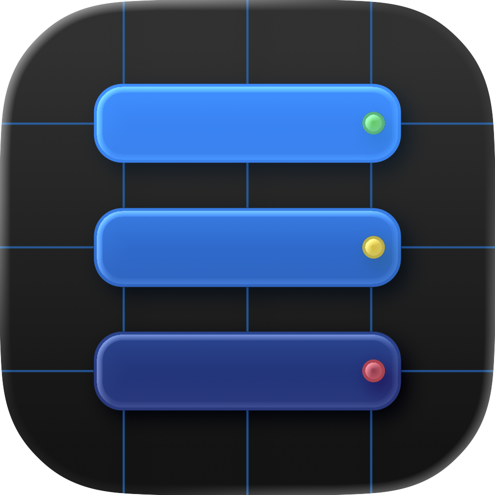

# Container Desktop

**The Apple container GUI for your Mac.**

A native macOS app for [Apple's `container` runtime](https://github.com/apple/container): run, inspect, and manage containers, images, volumes, networks, and machines, launch whole Compose stacks, migrate from Docker in one click, and watch live stats, all from a clean SwiftUI app.


[](https://github.com/marcelbaklouti/container-desktop/releases/latest)

</div>

<p align="center">
  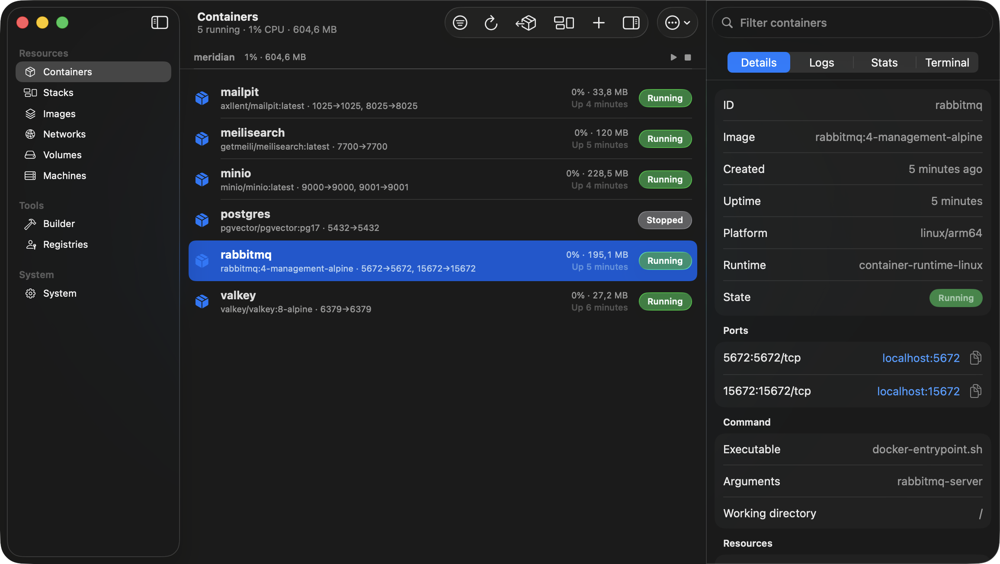
</p>

## Why Container Desktop

Apple's `container` runtime is fast and native, but it ships as a command-line tool. Container Desktop is the graphical surface it doesn't have: a real SwiftUI app (no Electron) that drives the same `container` CLI you already use, so everything you do in the app matches the terminal exactly. No accounts, no tracking, no license fees.

## Stacks, first class

Compose projects are not just labels here. Stacks are their own area in the sidebar: every project is one unit you can start, stop, and relaunch together, with per-service status at a glance.

- **Combined logs** stream from every service into one view, color-coded per service, with filtering, search, and a pop-out window.
- **Launch any compose file**: named volumes, project networks, dependency order, `build:` sections, variable interpolation with `.env`, and per-service progress.
- **Docker-parity labels** mean stacks you started elsewhere group correctly too.

<p align="center">
  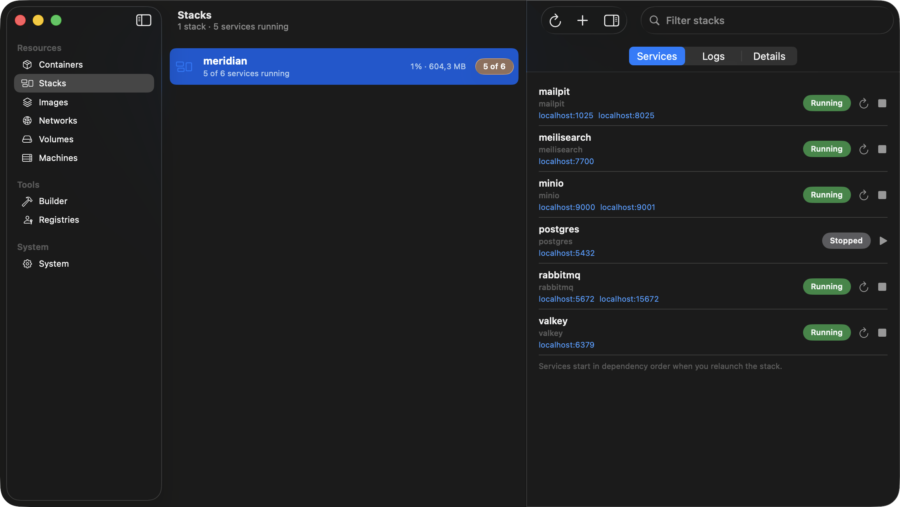
</p>

## Leave Docker in an afternoon

One click moves your containers over: images, settings, and the data in your volumes. Container Desktop reads your Docker Desktop setup, lets you pick what moves (per container or per stack), and recreates everything on Apple's runtime. The originals stay in Docker, stopped but never deleted, so there is nothing to undo.

<p align="center">
  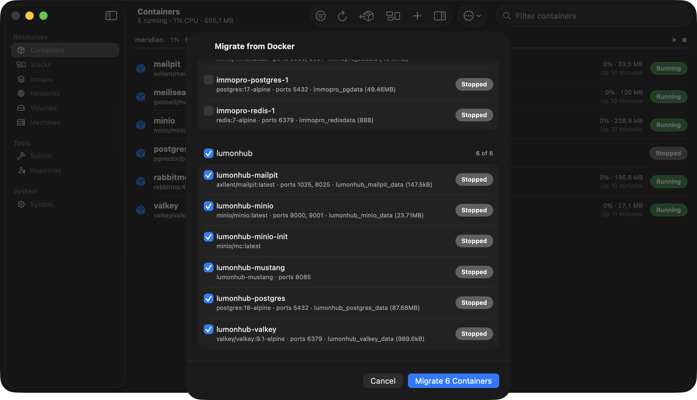
</p>

## Everything you can do

- **Containers**: run with a full options sheet (ports, volumes, environment, networks, resources, and Intel images via Rosetta), inspect, duplicate into a prefilled Run sheet, or copy any container as a `container run` command. Searchable logs with follow and save, live CPU and memory charts, an embedded terminal, and file copy in and out.
- **Images**: pull by reference, build from a Dockerfile with live output, tag, push to any registry you are signed into, import and export tar archives, view history, and prune with confidence, because every image shows whether a container actually uses it.
- **Networks and volumes**: create and delete, see real on-disk usage, and cross-references that show exactly which containers use what.
- **Machines**: the Linux VMs behind your containers, on screen. Create them with the CPU, memory, and image you want, set a default, resize later, and drop into a shell.
- **Registries**: sign in once to pull and push private images.
- **Builder**: the build VM on screen, with status and one-click stop and start. Image builds boot it automatically when needed.
- **System**: daemon start and stop, local DNS domains so containers are reachable at `name.domain`, disk usage, and kernel management.
- **Menu bar and notifications**: live summary, quick actions per stack and container while the main window stays closed, and alerts when something exits unexpectedly.
- **Keyboard-first**: ⌘1 through ⌘9 switch areas, ⌘N creates in every area, and the shortcuts you expect just work.
- **Guided setup and verified updates**: missing the `container` CLI? The app installs Apple's signed release for you. Updates stage in the background and apply with one click, and the app only ever accepts packages signed and notarized by Apple.

<p align="center">
  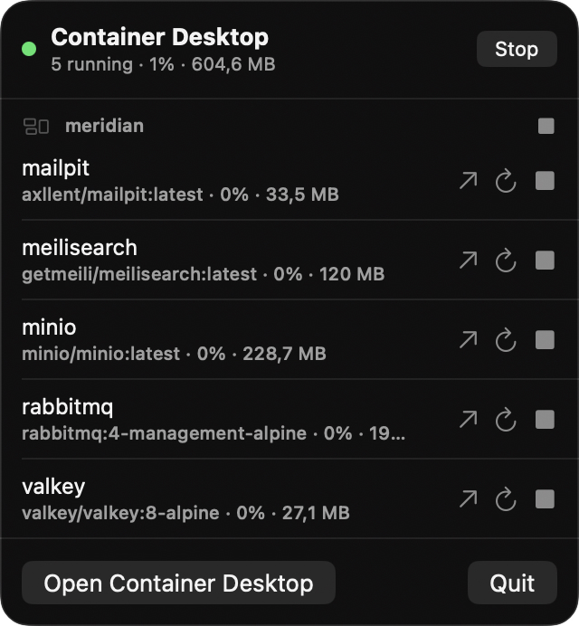
</p>

## Screenshots

| | |
| --- | --- |
| 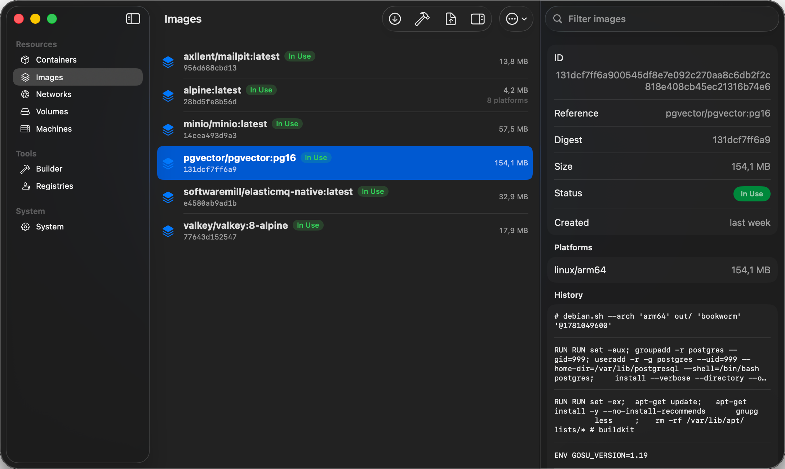 | 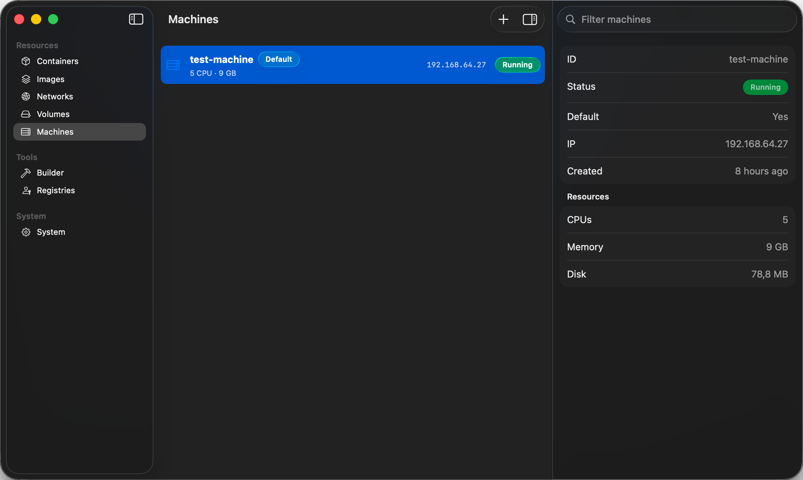 |
| **Images**: pull, build, push, import and export, history | **Machines**: the Linux VMs, with a shell |
| 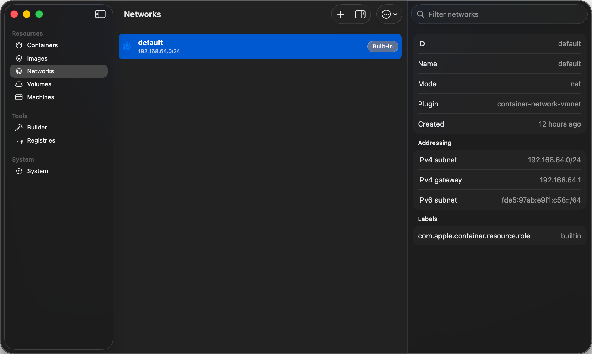 | 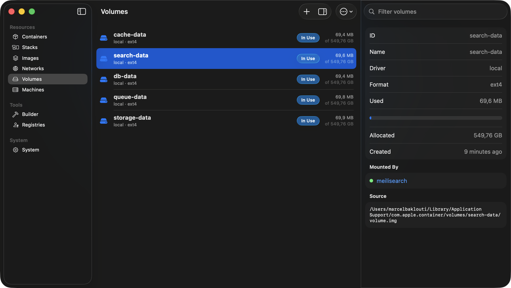 |
| **Networks**: isolation with member lists | **Volumes**: real on-disk usage and cross-references |
| 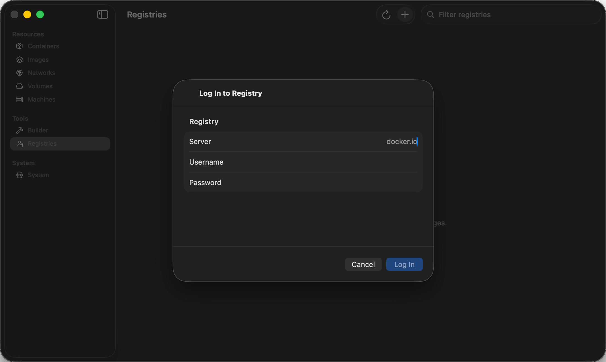 | 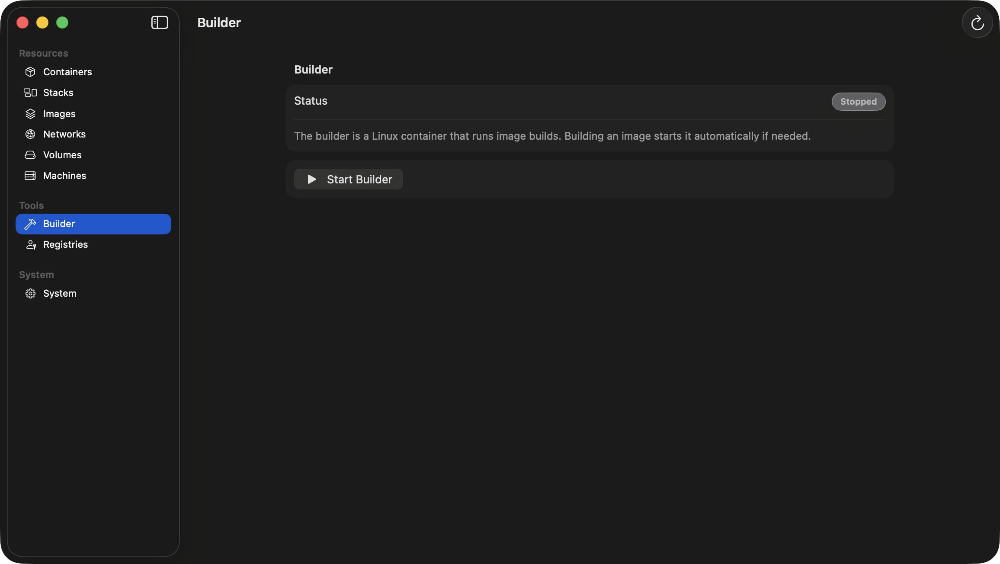 |
| **Registries**: sign in once, pull and push private images | **Builder**: the build VM, managed |
| 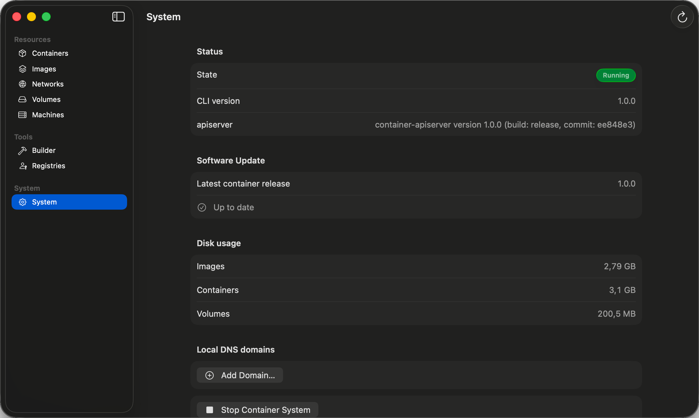 | |
| **System**: daemon, DNS domains, disk usage, updates | |

## Requirements

- **Apple Silicon** Mac
- **macOS 26 Tahoe** or later
- Apple's [`container`](https://github.com/apple/container) CLI (1.0.0+). Container Desktop can install and update it for you.

## Install

1. Download the latest **`.dmg`** from the [Releases page](https://github.com/marcelbaklouti/container-desktop/releases/latest).
2. Drag **Container Desktop** to your Applications folder and open it.
3. On first launch, if the `container` CLI isn't installed, Container Desktop offers to download and install Apple's official, signed release for you (with an administrator prompt). Then start the container system from the app or the menu bar.

Want something real to try immediately? Launch the [Meridian example stack](examples/meridian): Postgres with pgvector, Valkey, RabbitMQ, Meilisearch, MinIO, and Mailpit, all arm64 native, in one compose file.

## Not affiliated with Apple

Container Desktop is an independent, open-source project and is **not affiliated with, endorsed by, or sponsored by Apple Inc.** Apple, macOS, and Apple Silicon are trademarks of Apple Inc. The app is native in look and feel but does not use Apple's logo or trade dress.

## License

[Apache License 2.0](LICENSE).

---

## For contributors

The app is a hand-maintained `Containers.xcodeproj` (Xcode 26.6, Swift 6, macOS 26 target). The landing page lives in [`landing/`](landing/) (Next.js). What changed in each version is in the [CHANGELOG](CHANGELOG.md).

```sh
# Build the app (CLI)
xcodebuild -project Containers.xcodeproj -scheme Containers -configuration Debug build CODE_SIGNING_ALLOWED=NO
# Tests
xcodebuild test -project Containers.xcodeproj -scheme Containers -destination 'platform=macOS'
```

Cutting a release, with Developer ID signing, notarization, the DMG, and the GitHub release the in-app updater reads, is documented in [`RELEASE.md`](RELEASE.md) and automated by [`scripts/release.sh`](scripts/release.sh).

### References

- Apple container: [repo](https://github.com/apple/container) · [releases](https://github.com/apple/container/releases) · [CLI reference](https://github.com/apple/container/blob/main/docs/command-reference.md) · [technical overview](https://github.com/apple/container/blob/main/docs/technical-overview.md)
- [SwiftTerm](https://github.com/migueldeicaza/SwiftTerm) (embedded PTY) · [Swift Charts](https://developer.apple.com/documentation/charts) · [Observation](https://developer.apple.com/documentation/observation)
- [Developer ID & notarization](https://developer.apple.com/developer-id/) · [create-dmg](https://github.com/create-dmg/create-dmg)
